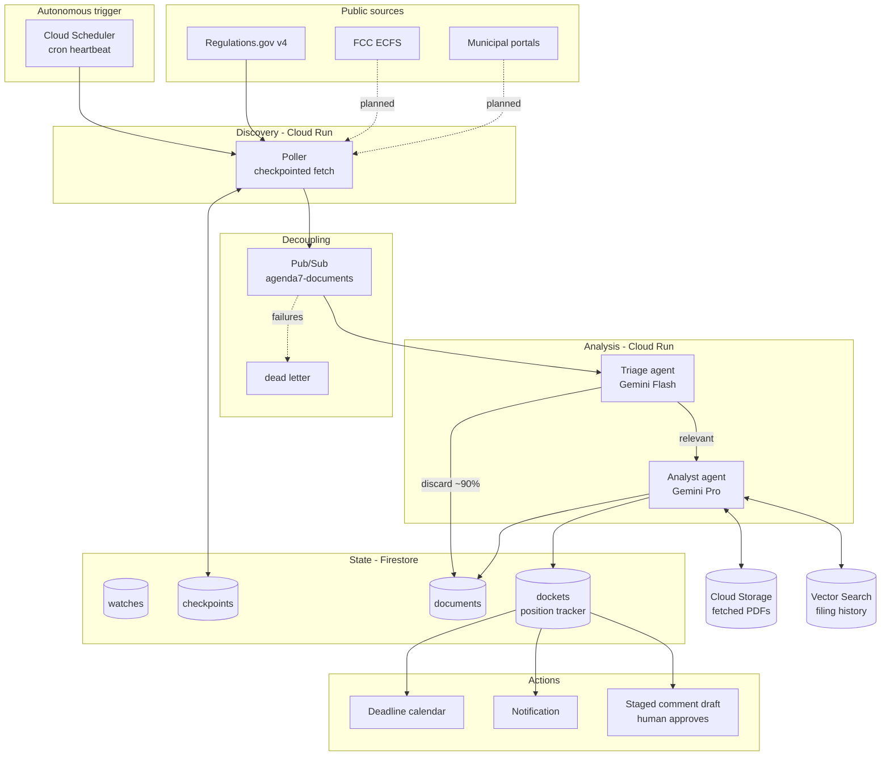

# Architecture

## The friction

Public comment periods are short, unannounced, and buried. Regulations.gov alone
posts thousands of documents a week; the ones that matter to any given person are
a handful, and finding them means reading hundreds of pages of PDF inside a window
that closes whether or not you noticed it opened.

Agenda Item 7 is a background agent, not a chatbot. Nobody asks it anything. It
wakes on a schedule, decides what is worth reading, reads it, folds what it learned
into a running position tracker, and puts the deadlines somewhere they cannot be
missed. A human only appears at the end, to approve a drafted comment.

## Flow

Same diagram as editable Mermaid source

## Why it is built this way

**The scheduler is the point.** The agent is defined by running when no human is
present. Cloud Scheduler is what makes this asynchronous rather than a request
loop wearing a costume.

**Two models, deliberately.** Flash triages everything cheaply and discards the
large majority; Pro only ever sees documents that survived the gate. This is a
cost decision as much as an architectural one - a $150 credit does not survive
sending every filing to a reasoning model.

**Pub/Sub between discovery and analysis.** A deep read of a 400-page PDF can
take minutes and can fail. Decoupling means a slow or failed analysis never
blocks discovery, retries are free, and poison messages land in a dead-letter
topic instead of wedging the pipeline.

**Checkpoints, not rescans.** A standard Regulations.gov key allows roughly 1,000
requests an hour. Each watch stores a high-water mark, so a re-run costs one
query per watch rather than re-walking history.

**The tracker mutates.** `dockets/` is not an append-only pile of summaries. Each
analysis folds into a single evolving record with a revision counter, so the
question "what is the state of this proceeding" has one answer instead of thirty
fragments.

**The agent never files anything.** It drafts and stages; a human submits. That
boundary is a design commitment, not a missing feature - an agent with authority
to submit into a public record is the wrong shape for this problem.

## Decisions forced by measurement

Each of these replaced an assumption that testing disproved. They are recorded
because the reasoning is not recoverable from the code alone.

**Retrieval is coarse; relevance is the agent's job.** The obvious design uses
the upstream `filter[searchTerm]` to find relevant documents. Measured against
the live API, that field is both too noisy and too sparse to carry relevance:
`"pole attachment"` with no agency filter returns 35 documents, mostly EPA
records about radiation and remedial design, while the same term scoped to the
FCC returns **zero** - from an agency with 456 documents in the window. So
watches retrieve broadly by agency and date, and the triage agent decides
relevance from metadata. This is why triage is load-bearing rather than
decorative, and it is also why the gate must be cheap.

**The relevance gate runs at temperature 0.** At default temperature the same
document (`FCC-2026-3204`) was rejected on one run and accepted on the next,
both reporting 0.90 confidence. Whether a filing is relevant cannot depend on
when it happened to be polled. Four identical calls at temperature 0 now return
identical verdicts. This reduces variance rather than guaranteeing determinism,
which is part of why rejections are stored with their rationale instead of being
silently discarded.

**"Seen" is not the same as "done."** Documents carry a stage, and only
`analyzed` and `rejected` are terminal. A document that passed triage but whose
download 403'd or whose analysis failed is *stuck*, and gets retried on the next
run. Existence-based dedup would bury it permanently - the worst possible
failure mode for a tool whose entire purpose is not missing things.

**Filings are staged to Cloud Storage, not streamed inline.** The analyst
receives a `gs://` URI. That avoids request-size limits on long filings, retains
the exact bytes that were analyzed for provenance, and makes re-analysis free of
another round trip to the agency.

**Model serving and infrastructure live in different places.** Gemini 3.x is
served only from the Vertex **global** endpoint; every 3.x model returns 404
from `us-central1`, even though `models.list()` reports those same models as
present in the region. Infrastructure (Cloud Run, Firestore, the bucket) is
regional. Config keeps these as two separate settings because conflating them
produces a 404 that looks like a permissions problem.

**Past dates are not deadlines.** Filings routinely cite dates that have already
passed - the Unified Agenda is largely historical - so the deadline view filters
to future dates by default. Surfacing an expired date as "upcoming" is worse
than showing nothing.

**Structural filtering is legitimate; topical filtering is not.** Watches may
restrict retrieval by `documentType` (for example to `Proposed Rule, Rule`).
This looks like the `searchTerm` mistake but is the opposite: `documentType`
is reliable metadata describing what *kind* of document something is, while
`searchTerm` guesses what it is *about* and does so badly. The difference is
measurable - FERC posts roughly 157 Notices a month but only about 30
rulemakings a year, and the rulemakings are where comment deadlines live.
Adding the filter took one watch from 0 relevant out of 25 to 5 out of 25,
without changing a single relevance judgement.

**Comment metadata is unreliable, so the document gets a vote.** Whether a
draft is worth staging is decided by `comment_window_open()`, which trusts the
API when it says a window is open but also accepts the filing's own extracted
deadlines as evidence. Observed on FERC-2026-3934: `withinCommentPeriod` false
and `commentEndDate` null, while the document itself set reply comments for a
date four weeks out. Correction and supplemental notices routinely carry no
comment metadata even when the proceeding is wide open, and trusting metadata
alone silently drops exactly the filings a person most wants to act on. The
check distinguishes a future *effective date* (nothing to file) from a future
*comment, reply, or protest* deadline (something to file), and the drafting
agent is separately told to say so in the body if a filing turns out not to be
open - which bounds a false positive to one wasted draft rather than a
misleading one.

## Source adapters

Every feed normalizes into `agenda7.domain.SourceDocument`. Nothing downstream of
the adapter knows which feed a document came from, so a second source is a new
module in `agenda7/sources/` and zero changes anywhere else.

## Data

All public. Regulations.gov, FCC ECFS, and municipal agenda portals. No private,
proprietary, or employer data is used anywhere in this project.
